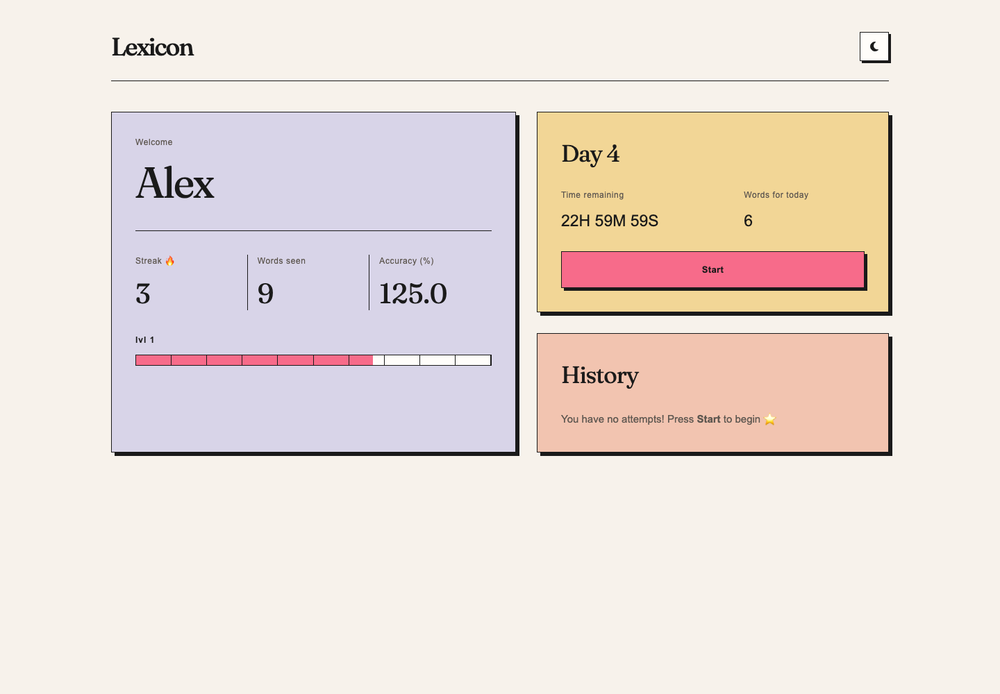
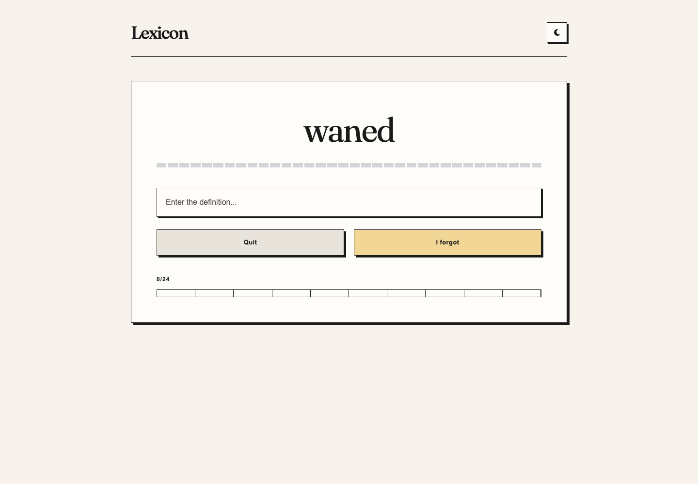
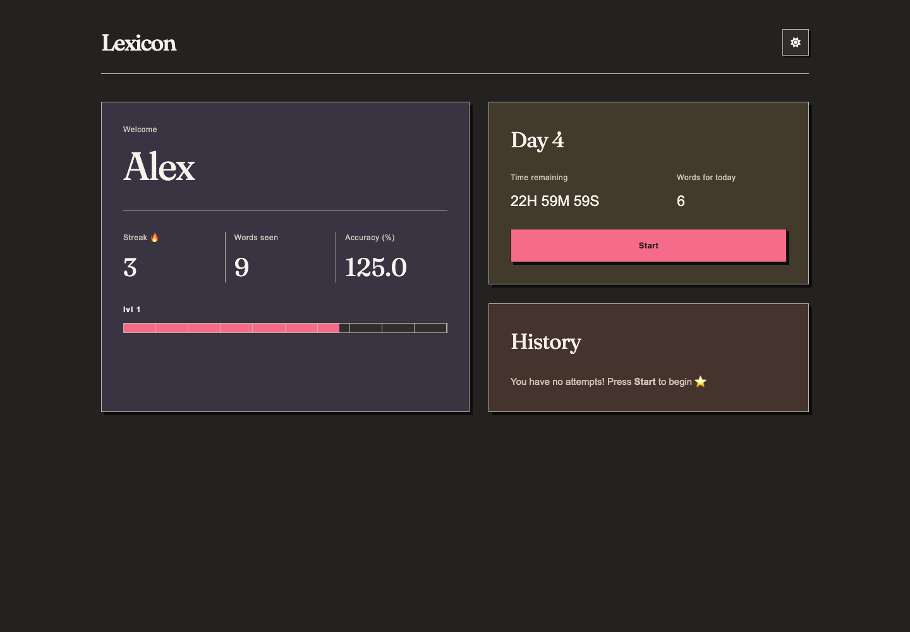
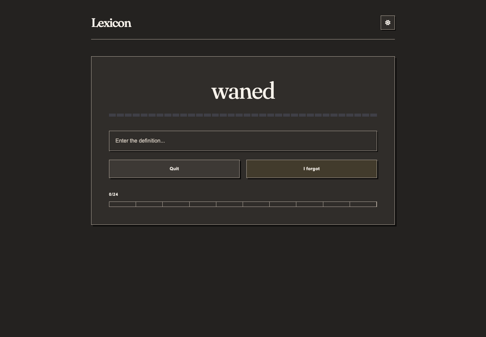

# Lexicon

**365 Days. 365 Words. Build Your Lexicon.**

Lexicon is a powerful word memorization app designed to help you embark on a 365-day vocabulary challenge. It utilizes a **spaced repetition algorithm** to optimize memory retention, combines learning with **gamification**, and ensures **local data persistence**, making the journey of building an advanced English vocabulary engaging and effective – one word at a time.

---

## 🔧 Features

-   **Efficient Vocabulary Learning:** Helps users learn advanced vocabulary effectively.
-   **Spaced Repetition Algorithm:** Uses a proven method to optimize memory retention and review schedules.
-   **Progress & Streak Tracking:** Monitors learning progress and tracks daily streaks to keep you motivated.
-   **Local Data Persistence:** Stores all user data locally in the browser, ensuring nothing is lost.
-   **Responsive Design:** Works beautifully and seamlessly across both desktop and mobile devices.
-   **Dark Mode:** Offers a comfortable viewing experience in low-light conditions.

---

## 🚀 Live Link

**Launch Lexicon →** [https://lexicon-app.vercel.app/](https://lexicon-app.vercel.app/)

---

## 🖼️ Screenshots

Desktop views of the redesigned interface, using sample local records.









---

## 💡 Why I Built This

I built Lexicon to address the common challenge of effective vocabulary acquisition. Traditional methods often lack engagement and retention strategies. My goal was to create an interactive and disciplined approach to learning new words daily, leveraging spaced repetition and gamification to transform a daunting task into a rewarding habit.

---

## 🧱 Challenges & Lessons

-   **Implementing Spaced Repetition:** Accurately building and integrating the spaced repetition algorithm to optimize review intervals based on user performance.
-   **Local Data Management:** Efficiently handling and persisting user progress, streaks, and word data using local storage without compromising performance.
-   **Gamification & UX:** Balancing the learning aspect with engaging gamified elements and an intuitive user experience to encourage daily interaction.

---

## 🧠 What I Learned

-   The profound impact of spaced repetition on long-term memory retention for learning new information.
-   Best practices for managing and structuring client-side data persistence with local storage for offline-first applications.
-   How thoughtful UI/UX design, combined with subtle animations (Framer Motion), can significantly enhance user engagement and learning motivation.

---

## 🗂️ Tech Stack

-   **React.js** – Frontend Library
-   **Tailwind CSS** – Utility-first styling
-   **Vite** – Fast build tool
-   **Motion (Framer Motion)** – Animation library
-   **Local Storage** – Data persistence
-   Deployed with **Vercel**

---

## 📦 Future Enhancements

-   **User Authentication:** Allow users to sync progress across devices.
-   **Custom Word Lists:** Enable users to add their own words or import lists.
-   **Detailed Analytics:** Provide more in-depth insights into learning patterns and progress.
-   **Audio Pronunciations:** Integrate audio for word pronunciations.

---

## 📁 Project Setup

Clone the repo and run locally:

```bash
git clone https://github.com/the-ajay-panigrahi/lexicon
cd lexicon
npm install
npm run dev
